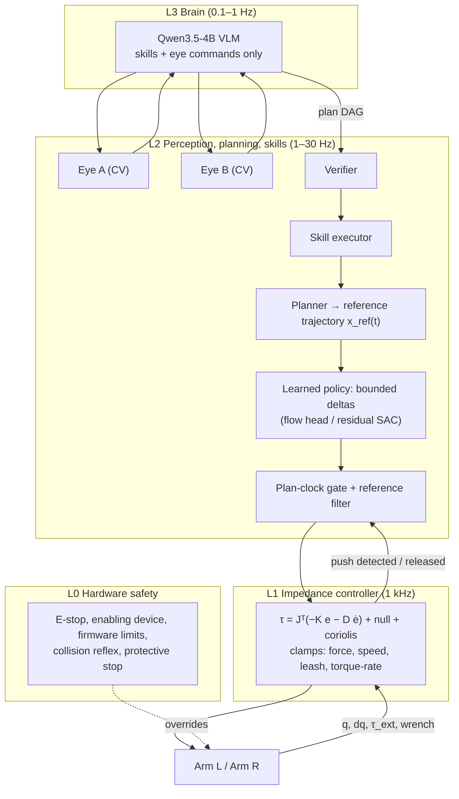
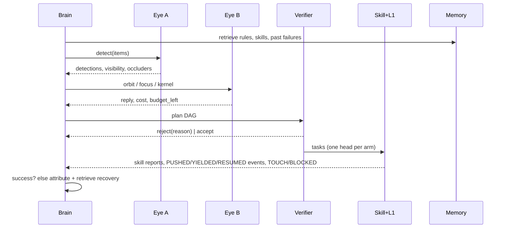
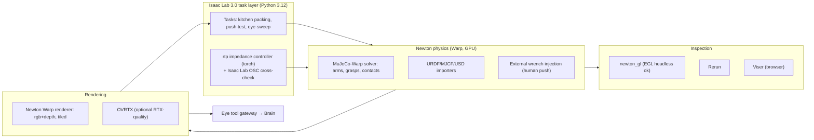
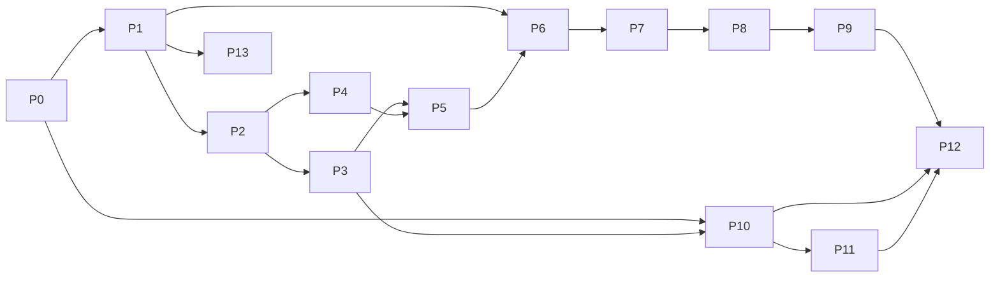

# robot-team-packing — Implementation Plan (v2, replaces the earlier draft)

> **User's current authoritative instruction:** [`docs/USER_PLAN_VERBATIM.md`](docs/USER_PLAN_VERBATIM.md). Follow it where it differs from this file until a new plan is supplied.

Date: 2026-11-17. Status: **working plan.** Some gates have since been measured; §12 records the
status of each gate against a report, and `docs/STATUS_HONEST.md` is authoritative for claim status.
Base: `origin/main` @ `a50347f`. `paper/` text is aligned in place; its figure SVG/PDF are frozen.
Specs referenced from here: `docs/IMPEDANCE_SPEC.md` · `docs/SIMULATION.md` · `docs/HARDWARE.md` · `docs/COMPATIBILITY.md` · `docs/KAGGLE_MODELS.md` · `docs/SCHEMAS.md` · `docs/SOURCE_REGISTER.md` · `harness_files/brain/{rules,skills}.md`.

Labels: **[V:S-nn]** verified in a source I read (register: `docs/SOURCE_REGISTER.md`) · **[R]** from the repo's own docs, not re-checked · **[D]** decision taken by this plan (default, changeable by you) · **[G]** unverified; settled by a named verification gate, never assumed.

---

## 1. Decisions this plan is built on

| id | decision | origin |
|---|---|---|
| D-25 | Simulation = **Isaac Lab 3.0 + Newton only**. No other simulator or renderer stack is used. | you |
| D-26 | Robot safety around humans is a **property of the robot's own controller**: Cartesian **impedance control** so a human can push an arm, the arm behaves as a spring, then returns to its planned pose. Object fragility is not a design driver. | you |
| D-27 | Kaggle-hosted frontier models (Claude Opus/Sonnet/Haiku, Gemini family, others) are the teacher/judge pool. Access, terms and quota are **yours to authorise**; the model catalogue and calling method come from the Kaggle skill you will supply, with Kaggle CLI auth. | you |
| D-28 | Build from the ground up. Defaults below are decisions; each unverified item has a gate with a pass/fail criterion instead of a question. | you |
| D-29 | Arms: **two Franka Research 3** (7-DoF, torque sensor in every joint, 1 kHz torque interface, open Cartesian-impedance reference controllers incl. a dual-arm example). Gripper: Franka Hand. | [D] |
| D-30 | Eyes: two PTZ cameras on motorised ring-rail carriages with 12 calibrated stations (Eye-A), machine-vision + servo pan/tilt as fallback (Eye-B). | [D] |
| D-31 | Control layering: L0 hardware safety → L1 1 kHz impedance → L2 planner/skills/learned policies → L3 Brain. Learned policies emit only bounded deltas. | [D] |
| D-32 | Brain training coverage, profiles, per-profile isolation, Qdrant+BM25, LangGraph: as in the repo's V2 architecture, unchanged **[R]**. | repo |
| D-33 | **Local-first sequencing.** Everything that does not need Kaggle is built and run locally first. Teacher/judge data generation uses the Kaggle-hosted frontier models, exactly as in your plan; it starts when you supply the skill and CLI auth. There is no substitute data source. | you |
| D-34 | **Assets: SimReady first.** Objects, furniture and kitchen structure come from NVIDIA SimReady USD assets (`docs/ASSETS.md`); robots from manufacturer models (Franka URDF/USD/MJCF, MuJoCo Menagerie MJCF). Own CAD only for fixtures that do not exist (ring rail, mounts). | you |

---

## 2. What the research established (that the plan relies on)

**Simulation stack**
* Isaac Lab 3.0 is GA, one task API over multiple physics/render/visual backends; **Newton is a Warp-native physics backend (MuJoCo-Warp, VBD, MPM solvers) that runs without any GUI runtime** [V:S-10, S-11]. Isaac Lab 3.0 needs Python 3.12 [V:S-15].
* Cameras are renderer-backed: **Newton Warp** (lightweight ray tracer in the base install, tiled, supports only `rgb` and `depth`), or **OVRTX** (RTX-quality, via `isaaclab_ov`, ovrtx v0.5.1) [V:S-12, S-13]. Visualizers: `newton_gl` (works headless through EGL), Rerun, Viser [V:S-14].
* Newton: imports **URDF, MJCF and USD** (`add_urdf/add_mjcf/add_usd`); `Control` carries `joint_target_pos/vel` and **`joint_f` (effort mode)**; actuators are composable; external forces are applied in the step loop; solvers XPBD, VBD, MuJoCo-Warp, Featherstone, SemiImplicit [V:S-18]. GPU floor: Turing (cc 7.5+), driver R580+ for Warp 1.18 (else Warp 1.17.0) [V:S-17, S-19].
* Isaac Lab already ships an **`OperationalSpaceController`** with `impedance_mode ∈ {fixed, variable, variable_kp}`, task-space stiffness/damping (`d = 2·√k·ζ`), inertial decoupling, gravity compensation, null-space control and contact-wrench control [V:S-16]. It is the sim cross-check for our own controller.
* **External force on Newton (exact calls):** in Isaac Lab, `asset.permanent_wrench_composer.set_forces_and_torques(forces, torques, body_ids, env_ids, …)` / `.add_forces_and_torques(…)` for persistent wrenches and `asset.instantaneous_wrench_composer` for single-step wrenches (frames BODY or WORLD_AT_COM, optional application point in the link frame); `set_external_force_and_torque()` is deprecated. On Newton the asset writes `state_0.body_f`; a fix (Isaac Lab PR #8269) makes `NewtonManager` re-apply it on **every solver substep** (before it, wrenches acted only on the first substep) [V:S-31]. Directly in Newton: clear `State` forces, write the wrench into `state.body_f`, collide, `solver.step` [V:S-18]. Joint reaction wrenches on Newton need `ArticulationCfg.enable_joint_wrench` set before start [V:S-31].
* **FR3 for Newton exists:** Franka publishes FR3 (v1, v2, v2.1), **FR3 Duo** (dual-arm bracket + head) and accessory models as CAD, URDF, USD and MJCF [V:S-32]; MuJoCo Menagerie ships `franka_fr3`, `franka_fr3_v2` and `franka_fr3_duo` (tabletop and spine variants), Apache-2.0, derived from `frankarobotics/franka_description` v2.9.0 [V:S-33]. A public dataset reports a bimanual FR3 Duo with Robotiq 2F-85 simulated on **Newton 1.6 with the MuJoCo-Warp backend** [V:S-34]. Newton loads MJCF/URDF/USD via `add_mjcf/add_urdf/add_usd` [V:S-18]; Menagerie actuators are position actuators, so the impedance controller overrides them with effort mode (`joint_f`).
* **SimReady assets exist and are open:** `nvidia/simready-assets` (2,677 USD assets with physics, CC-BY-4.0, ~490 GB); `imagineio/PhysicalAI-SimReady-Assets` (public object/material/HDRI packages, each with a `com.nvidia.simready.packaging.json` giving owner + licence); kitchen-tagged `imagine-io/PhysicalAI-Simready-Kitchen-Assets` (CC-BY-4.0); `imagineio/PhysicalAI-SimReady-Homes` (multi-room scenes, ~319 objects each, kitchen layout parameters; gated, non-commercial research); `ALLSIDES/simready-scanned-objects` (69 scanned real objects, CC-BY-4.0) [V:S-35]. Newton's USD importer uses schema resolvers to bridge PhysX/MuJoCo USD schemas [V:S-18]. Details: `docs/ASSETS.md`.
* Limits **[V:S-12/S-13/S-14]**: Newton Warp renders only rgb/depth (no instance-segmentation or normals through it) → segmentation for eyes comes from our own CV or from sim ground truth; `newton_rtx` visualizer cannot capture headlessly.

**Impedance control on the real arm**
* Franka's reference controller computes `τ = Jᵀ(−K·e − D·J·q̇) + nullspace PD + coriolis`, damping from `D = 2√K`; example stiffness 150 N/m (translation), 10 Nm/rad (rotation); torque-rate saturation `delta_tau_max = 1 Nm/ms`; target low-pass filter 0.005; a **dual-arm** Cartesian impedance example exists; collision-behaviour thresholds are set **outside** the control loop; the examples warn to keep the user-stop at hand [V:S-20, S-21].
* The firmware's own Cartesian impedance can be set up to [3000 N/m ×3, 300 Nm/rad ×3] [V:S-21]. HIL-SERL's `serl_franka_controllers` adds clipping and integral terms to the same law [V:S-22].
* FR3 itself: 7 DoF, 3 kg payload, 855 mm reach, ±0.1 mm repeatability, torque sensors in all 7 joints, FCI 1 kHz, `libfranka` open source [V:S-23].

**Kaggle models**
* Kaggle-hosted models are reached through the interface described by the Kaggle skill you will supply (D-27, D-33). The plan treats the teacher as a swappable client behind `rtp/teacher/client.py` with image-in, structured-out, tool-use calls; the schema and quality gates do not depend on which provider answers.

**Brain**: Qwen3.5-4B dense hybrid (8 × [3 Gated DeltaNet + 1 gated attention]), hidden 2560, 32 layers, 262k context, Apache-2.0 [V:S-08]; fast path needs `flash-linear-attention` + `causal-conv1d` else a slow fallback [V:S-09].

---

## 3. Architecture

### 3.1 Layers

### 3.2 Hard responsibility split
| layer | may | must never |
|---|---|---|
| Brain | skill calls with declared params, eye tools, retrieval queries, replans | emit joints, waypoints, gains, stiffness, speeds, torques; bypass the verifier |
| Eyes | pose/zoom/kernel/detect on request, report geometry | move arms, plan |
| Planner/skills | collision-free reference `x_ref(t)`, phase sequencing, stiffness *profile selection from an allow-list* | exceed L1 limits |
| Learned policy | bounded Cartesian/stiffness deltas | torque commands; leave the bounds |
| L1 | track `x_ref` as a spring-damper, **yield to external force**, clamp | be disabled by a higher layer |
| L0 | stop / limit independent of software | depend on L1–L3 |

### 3.3 One planning round (Eye ↔ Brain ↔ Arm)

New arm events for the Brain: `PUSHED` (human displaced the arm beyond a threshold), `YIELDED` (plan clock paused), `RESUMED` (returned within tolerance). The Brain never overrides the pause; it may only replan after `RESUMED` or time out into a safe retreat.

---

## 4. Human-safe compliant behaviour (headline requirement; full spec in `docs/IMPEDANCE_SPEC.md`)

Behaviour: a person pushes any part of an arm → the arm deflects like a spring-damper and the **trajectory pauses** → on release the arm returns to its planned pose smoothly, at bounded speed, without overshoot, then the trajectory resumes.

Core law at L1 (1 kHz): `F = −K·(x − x_ref) − D·ẋ`, `τ = Jᵀ F + (I − Jᵀ J⁺ᵀ)·τ_null + τ_coriolis` — the structure of Franka's reference controller [V:S-20], with `D = 2ζ√(K·Λ)` (Λ = identified Cartesian inertia) instead of the example's inertia-free `2√K`. Added by us **[D]**:
1. **Plan-clock gate**: if `‖F_ext‖ > F_push` or `‖e‖ > e_pause`, `x_ref` stops advancing; after release (`‖F_ext‖ < F_release` for ≥ 200 ms) the reference is eased back along the plan at ≤ `v_return`.
2. **Leash**: `‖x_ref − x‖ ≤ δ_max` so the spring force can never exceed `K·δ_max`; beyond it the reference follows the person.
3. **Force/torque/speed clamps** and torque-rate limit (1 Nm/ms as in the reference example [V:S-20]).
4. **Whole-arm compliance**: null-space PD is weak enough that pushing the elbow also yields (tested separately from end-effector pushes).
5. **Stiffness profiles** from an allow-list per skill phase (`free_motion`, `approach`, `grasp`, `transport`, `place`, `retreat`, `handover`); learned policies may modulate within `[K_min, K_max]` only.

Initial numeric defaults are **starting points [D]**, set in `docs/IMPEDANCE_SPEC.md`, and become real only after Phase 3 (sim) and Phase 10 (hardware, with the applicable limits from ISO 10218-2:2025 read from the standard). **Impedance behaviour is not claimed to be a safety guarantee**; it is a validated, measured property, backed by L0 (§7).

---

## 5. Hardware (details and comparison: `docs/HARDWARE.md`)

* **Arms [D-29]:** 2 × Franka Research 3. Chosen because compliant control needs joint torque sensing and a real-time torque interface: FR3 has both [V:S-23], and Franka publishes the exact impedance structure we extend [V:S-20, S-21]. Alternatives kept behind the L1 interface: Kinova Gen3 (1 kHz, torque sensors, `ros2_kortex`), Flexiv Rizon 4/4s (per-joint torque, strong safety documentation) [V:S-24, S-25]. UR e-Series rejected as primary (no joint torque sensing; secondary source).
* **Payload note:** FR3 carries 3 kg including gripper → light kitchen objects only **[L]**.
* **Eyes [D-30]:** Eye-A = ONVIF PTZ IP camera (absolute/relative PTZ, RTSP) on a belt/rack carriage on a ring rail, stepper/servo + encoder + homing/limit switches. Eye-B = machine-vision camera + motorised zoom lens + servo pan/tilt on the same carriage. Geometry defaults **[R]**: radius 1.2–1.8 m, height 2.2–2.6 m, 12 stations, tilt 25–55°, 1–4× zoom. PTZ absolute-move repeatability varies by device [V:S-29] → **calibrated stations + per-zoom intrinsics + fiducial refinement** is the design, and repeatability is a Phase 11 gate.
* **Localisation without sim ground truth:** table-plane back-projection + two-eye triangulation first; depth modules per eye only if Phase 11 error exceeds the grasp tolerance.
* **Compute:** RT-PC (PREEMPT_RT, wired) running only L1 per arm; Brain/vision workstation separate; PTP/chrony time sync.

---

## 6. Simulation (details: `docs/SIMULATION.md`)

* One task API, same code on every CUDA profile; heavy things (OVRTX, many envs) only where the GPU allows. You inspect scenes in `newton_gl` (local window or EGL video), Rerun, or Viser in a browser.
* Assets (D-34, `docs/ASSETS.md`): arms and hands from Franka's official FR3/FR3 Duo and accessory models (URDF/MJCF) with MuJoCo Menagerie `franka_fr3_v2` / `franka_fr3_duo` as the ready-made MJCF route; kitchen structure, appliances and objects from **SimReady USD assets** (CC-BY-4.0; attribution generated automatically); scanned real-object SimReady packages where we own the real object; own CAD only for the ring rail, carriages and mounts. Every asset passes the ingestion gates G-5 / G-13.
* Validation per asset: mass/inertia vs datasheet, joint limits/effort, zero-pose reach test, no interpenetration, impedance step response vs analytic mass-spring-damper, licence logged.
* Evidence rule: nothing is called a result unless produced by the Isaac Lab + Newton pipeline with a recorded config hash and seed.

---

## 7. Safety around humans (layered; the impedance layer is one layer)

| layer | mechanism | independent of software above |
|---|---|---|
| L0-a | hard-wired E-stop + enabling device (FR3 provides a safety-rated enabling input per a reseller listing **[G]**) | yes |
| L0-b | firmware joint/Cartesian/force limits, collision reflex, protective stop; thresholds set outside the control loop [V:S-21] | yes |
| L0-c | area sensor (safety laser scanner / curtain) wired to arm safety inputs for speed-and-separation monitoring, model chosen in Phase 10 **[G]** | yes |
| L1 | impedance law, plan-clock gate, leash, clamps (§4) | software, tested |
| L2/L3 | verifier, skill checks, Brain rules | learned/software |

Standards: ISO 10218-1/-2:2025 absorbed ISO/TS 15066 incl. power-and-force limiting; collaboration is judged per application; integrator owns the cell risk assessment; EN ISO 10218 references appeared in the EU OJ 7 Sep 2026 (secondary) [V:S-26]. **Phase 10 acquires the standards** and fixes the contact-force/pressure limits from them; until then the numeric force limits in the spec are placeholders. Staged human proximity: cell empty → human enters only with arms in monitored standstill → speed-and-separation coexistence → push/contact trials with a force/pressure measuring device. Task rule while a person is in reach: no sharp or hot tool in an end-effector.

---

## 8. Brain, retrieval, training

* **Model** facts: §2. Adapter coverage (D-07/08/09 [R]): full-attention `q/k/v/o_proj`; DeltaNet `in_proj_qkv, in_proj_z, in_proj_b, in_proj_a, out_proj`; MLP `gate/up/down`; vision blocks `qkv, proj, linear_fc1, linear_fc2`; merger `linear_fc1, linear_fc2`; frozen: `A_log`, `dt_bias`, `conv1d`, gated norms, embeddings. DeltaNet recurrent state stays fp32. Gate G-1 re-dumps the real module names before any adapter is attached.
* **Profiles** (matrix and isolation: `docs/COMPATIBILITY.md`): RTX 4050 → QLoRA; RTX 4090 → BF16 LoRA + FlashAttention-2; dual T4 → fp16 LoRA + SDPA (no bf16, no mainline FA2 on Turing **[R]**); Pro 6000 → inherits 4090; TPU v5e-8 / v6e-1 / v5e-1 → stubs until G-12. Selecting `ACTIVE` derives every path, config, checkpoint, optimizer state, log; nothing writes outside its profile tree.
* **Training**: SFT (LoRA/QLoRA across all block types) → frozen merged SFT reference → GRPO with `KL(π‖π_SFT)` budget that **stops** a run when exceeded → hindsight relabelling → retrieval-assisted recovery. Rewards: format, feasibility, rule compliance, closed-loop success in sim, eye cost, length, **plus arm-yield compliance** (a plan that commands the arm to resume while `YIELDED` is rejected by the verifier and penalised).
* **Orchestration**: LangGraph graph `retrieve → eye_loop → plan → verify → execute → monitor(PUSHED/YIELDED/RESUMED) → attribute → recover|done`, checkpointed; pin and verify version at install **[G]**. **Memory**: Qdrant local, dense + sparse + BM25 with RRF (client-side RRF fallback), collections `harness_docs`, `episode_notes` **[R]**.
* **Brain thinking mode**: Qwen3.5 defaults to thinking; the Brain runs with a hard thinking-token cap and a stated-rationale field; decided by ablation in Phase 8.

## 9. Kaggle-hosted frontier models as teachers (details: `docs/KAGGLE_MODELS.md`)

Pool: whatever your Kaggle skill exposes, tiered by measured accepted-example yield per unit cost (not by name): **strong**, **bulk**, **cheap**, **open-weight diversity**. Roles:
1. **Teacher**: given rendered eye frames (Newton Warp) + structured OBS + rules + tool list, output parseable tool calls + plan DAG + short stated rationale.
2. **Judge**: score a rollout's plan quality and attribute a failure (eye/brain/arm), cross-checked against the programmatic verdict.
3. **Hard-case miner**: propose arrangements that break the current Brain from failure notes.
4. **Compliance-aware teacher**: scenarios where a human pushes an arm mid-plan; teacher must produce correct wait/replan behaviour.
5. **Agreement signal**: ≥2 teachers agreeing + verifier pass = high-confidence example.
Nothing is trusted because a teacher said it: every example passes the **verifier gate**, then a **sim-replay gate** (success or attributed failure), then eye-efficiency and diversity filters. Only emitted text is stored (no hidden reasoning assumed). The budget controller reads quota/cost from the interface the skill provides and stops at 80 %. Teacher data comes only from the Kaggle-hosted models; the pipeline is built and tested now against recorded response fixtures, and generation starts when the skill and CLI auth arrive.

## 10. Data, benchmarks and contribution evidence

* **Episode capture** (all runs): raw+processed frames, both eye states/commands, OBS, Brain inputs/outputs, tool calls/results, plans, arm reports, **L1 telemetry (e, F_ext, clamps, push events)**, outcome, recovery (`docs/SCHEMAS.md`).
* **Benchmark**: frozen seeds in the Isaac Lab + Newton kitchen; splits: train / held-out arrangement / held-out eye station / held-out object instance / occlusion level. External dual-arm check: RoboTwin 2.0 via a symbolic-skill adapter (baselines ACT, DP, DP3, RDT, π0; Franka/UR5 embodiments) [V:S-28].
* **Baselines**: our ablations; π0/RDT/ACT/DP fine-tuned on demonstrations from our own sim; frontier model as zero-shot Brain via Kaggle; base Qwen3.5-4B with identical tools.
* **Metrics**: localisation mAP/centre error; occlusion success vs visibility; viewpoint information gain and success-vs-budget; eye-tool redundancy; two-arm handover/lock conflicts; manipulation success; wall-clock; recovery rate; collisions; **compliance metrics (push displacement vs F/K, settle time, overshoot, return speed, peak force, plan-pause correctness, resume error)**; generalisation with Wilson intervals / paired bootstrap **[R]**.
* **Contribution candidates (conditional on measurement)**: costed active two-eye control by a small VLM; Eye/Brain/Arm failure attribution; block-coverage ablation for a DeltaNet/attention VLM; retrieval recovery + hindsight; a VLM-planned dual-arm system whose arms are measurably compliant to human pushes. Novelty is checked by a literature survey at the start of Phase 9 before any claim. No result is stated before it exists.

## 11. Notebooks and Kaggle asset cache

`./notebooks/` is not in `origin/main`; Phase 1 creates it. Every notebook begins with the same cells:
1. `ACTIVE = "<profile>"`. 2. Detect Kaggle (`/kaggle/input`), print GPU/driver, run `ops/preflight.py`. 3. `rtp.assetcache.resolve(spec, kind, profile)` for the **wheelhouse** (prebuilt `causal-conv1d`, `flash-linear-attention`, `flash-attn` where supported, Newton/Warp wheels, `qdrant-client`, …) → offline install if attached, else online install, else build. 4. `resolve()` for models (Qwen3.5-4B pinned to a commit; NF4 copy for 4050/T4). 5. Fast-path assertion. 6. Print "attach these datasets next time". 7. Run the stage with periodic copy-out of checkpoints.

Resolution order: **attached Kaggle dataset → local cache → normal download → (if `EXPORT_TO_KAGGLE=True`) write `dataset-metadata.json` with `isPrivate: true` and upload as a private dataset**; manifest (source revision, sha256, python/torch/cuda/sm tags) verified on every load; credentials only from Kaggle Secrets/env. Slugs: `rtp-model-qwen35-4b-<rev8>`, `rtp-model-qwen35-4b-nf4-<rev8>`, `rtp-wheels-py<v>-torch<v>-cu<v>-sm<cc>`, `rtp-adapters-<profile>-<stage>-<hash8>`, `rtp-data-<profile>-<kind>-<hash8>`. Limits to design around: `/kaggle/working` ≈ 20 GB, private datasets ≈ 100 GB total (figures vary by source) [V:S-30, secondary]; Qwen3.5-4B bf16 ≈ 9.3 GB [R]. The local cache path is built and tested first; the Kaggle export/attach path is switched on when your CLI auth is supplied (G-11, non-blocking). Check Kaggle Models for an existing Qwen3.5-4B first (attach without dataset quota).

---

## 12. Verification gates (replace guessing; each has a pass criterion)

| gate | verifies | pass criterion | phase |
|---|---|---|---|
| G-1 | real Qwen3.5-4B config/modules/chat template; dense vs MoE | module dump matches adapter map; dense confirmed. **Status: PASS** — `reports/qwen35_modules.json` (738 tensors, 4.66 B parameters, dense; module tree in DECISIONS §F). | 0 |
| G-2 | DeltaNet fast path per GPU | `is_fast_path_available`; 100-step finite loss; tokens/s + peak VRAM logged. **Status: PASS on the 4050** — `reports/g2_fastpath.json` (100 steps, 329.5 tok/s at seq 256, peak 4.99 GB; DECISIONS §F). | 0/2 |
| G-3 | Newton-only Isaac Lab install runs a camera task with `physics=newton_mjwarp` + Newton Warp renderer | **PASS on both**: 4050 (`reports/g3_sim.json`) and Kaggle T4 (`reports/g3_sim_t4.json`) — 30 steps, rgb+depth contracts, all six checks, versions logged (D-39, D-51). One device at a time (D-50); cube-fall, not manipulation. | 0/2 |
| G-4 | Teacher client integration (runs when your Kaggle skill is supplied; **non-blocking** for every other phase) | `rtp/teacher/client.py` returns a parseable plan for an image+text scene from ≥ 1 model per tier; cost per call logged. **Status: NOT RUN / no report** — `RTP_SERVE_URL` unset; no frontier model ran, scripted teacher traces only (D-53). | 7 |
| G-5 | FR3 / FR3 Duo + Franka Hand load in Newton from Franka's official model (`add_urdf`/`add_mjcf`) and from Menagerie `franka_fr3_v2`/`franka_fr3_duo`; effort-mode override works | masses/limits within 2 % of datasheet; zero-pose reach test; both sources agree on kinematics within 1 mm. **Status: NOT RUN / no report** — an FR3 MJCF from Menagerie was just downloaded (`reports/robot_assets.json`), not imported or validated (D-54). | 2 |
| G-6 | sim impedance vs analytic mass-spring-damper | step response error ≤ 5 %; stable at chosen dt. **Status: PASS as a simulation-only cross-check** — `reports/g6_impedance.json`: max relative step error **0.27 %**, stable at 1 kHz, 10 N push and return measured; **not** Phase 3 acceptance, hardware validation or a safety certification (D-22, D-58). | 3 |
| G-7 | external wrench on EE and elbow via `permanent_wrench_composer` and direct `state.body_f`, with solver substeps > 1 | applied impulse per step = F·dt within 2 % (proves PR #8269 behaviour is in our Isaac Lab tag). **Status: NOT RUN / no report.** | 3 |
| G-13 | SimReady → Newton ingestion (`docs/ASSETS.md`) | ≥ 20 objects over ≥ 6 classes + 3 furniture pieces import; mass within 5 % of package metadata; 10 s drop test stable; scripted Franka Hand grasp ≥ 80 % on ≥ 10 objects; textures visible in the Newton Warp renderer. **Status: NOT RUN / no report** — ingestion in progress, no asset catalogue or asset-based scene (D-54). | 2 |
| G-8 | eye rendering throughput | ≥ 10 fps/eye at 640×480 on RTX 4090-class (recorded for other profiles). **Status: NOT RUN / no report.** | 4 |
| G-9 | PTZ repeatability | pan/tilt return error ≤ 0.1°, zoom intrinsics reproducible. **Status: NOT RUN / no report.** | 11 |
| G-10 | L1 loop jitter on RT-PC | p99 ≤ 100 µs at 1 kHz. **Status: NOT RUN / no report.** | 10 |
| G-11 | Kaggle private-dataset export/attach (after CLI auth; **non-blocking**) | round trip with manifest check. **Status: round-trips measured (D-40) but no dedicated G-11 report is committed; not marked PASS.** | 1 |
| G-12 | TPU feasibility for Qwen3.5 DeltaNet | runs smoke or marked `supported=False` with reason. **Status: NOT RUN / no report.** | 13 |
| G-14 | real-weight QLoRA SFT through `rtp.trainer`, then a **mid-epoch resume from the pushed checkpoint** | `ops/sft_smoke.py`: steps taken on the 4B model, losses finite, checkpoint written, second session resumes at the pushed step and continues past it; peak VRAM + wall time logged. **Status: PASS** — `reports/sft_smoke.json`: 4 steps (loss 0.8764 → 0.2364), checkpoint pushed to HF, fetched and resumed at step 2, peak 5.85 GB (D-48). A smoke, **not a reportable trained model** (D-57). | 8 |
Thresholds are **[D]** and may be tightened, not loosened, without a logged decision. A gate is marked PASS only when a report exists in `reports/`; measured gate evidence is never pooled with model-quality or hardware evidence (D-57).

---

## 13. Phases (sequential; each lists the 12 required items)

**Local-first order (D-33):** P0–P6, the sim-side parts of P9, and P10–P11 preparation run without Kaggle. P7 (teacher data from Kaggle-hosted models), P8 (SFT/GRPO on that data) and the Kaggle cache export (P1/G-11) start when you supply the skill and CLI auth. Brain-training code (P2) is built and smoke-tested locally on format-only fixtures.

Items: **1** objective · **2** decisions · **3** components · **4** sources · **5** tasks · **6** files · **7** deps · **8** tests · **9** acceptance · **10** risks/alternatives · **11** hardware/compute · **12** deliverables. Compute figures are estimates until measured.

### P0 — Foundations and legacy purge
1 Clean start under D-25. 2 Remove the legacy 2.3-era launcher stack. 3 Repo, HF, Kaggle. 4 S-01…S-09, S-30. 5 (a) delete `ops/12_env_isaac.sh`, the EULA export in `ops/env.sh`, the RT-core preflight branch, and replace the legacy bring-up scripts in `isaac/bringup/` and the runbook's old install section; rewrite the affected lines in `DECISIONS.md`/`docs/ARCHITECTURE_V2.md` to match D-25; (b) record the test baseline (the CPU-only 137/13/15 s figure here was **superseded** by the measured training-venv baseline in D-36; `README.md` carries the latest count); (c) run G-1, G-2, G-3. 6 `ops/`, `isaac/`, `docs/`, `reports/qwen35_modules.json`. 7 none. 8 `pytest` green; `grep` finds no legacy stack references outside history. 9 repo contains only the D-25 stack; gates G-1…G-3 recorded with pass/fail. 10 Newton-only install fails on a GPU/driver → pin Warp 1.17.0 (cc 7.5, R<580 path) [V:S-19]. 11 any GPU box + Kaggle T4 session. 12 clean repo, gate report.

### P1 — Profiles, installers, cache, notebooks
1 `ACTIVE` configures everything; assets download once and cache privately on Kaggle. 2 §8, §11. 3 `uv`, wheelhouse, `huggingface_hub`, `kaggle`/`kagglehub`, bitsandbytes, transformers, peft, trl, vllm, fla, causal-conv1d, flash-attn (Ampere+), Isaac Lab 3.0 Newton-only install, qdrant-client, langgraph. 4 S-08, S-09, S-15, S-30. 5 `rtp/profiles.py`; `rtp/assetcache.py`; `ops/install.sh --profile`; the notebooks (`00_setup_cache`, `10_sft_brain`, `20_grpo_brain`, `30_eye_training`, `40_world_and_datagen`, `50_isaac_newton_eval`, `60_harness_zero_shot_cot`, `70_hindsight_memory`, `80_evals_omni_comparison`, `90_attribution_paper_tables`); path-escape guard; `state.json` stage skipping; local cache first; Kaggle export/attach and G-11 after CLI auth. 6 `rtp/profiles.py`, `rtp/assetcache.py`, `ops/install.sh`, `notebooks/`, tests. 7 P0. 8 no path leaves its profile tree; manifest mismatch refused; offline install from a synthetic wheelhouse; kill/resume; two profiles side by side; dry-run mode. 9 clean machine → first training step from "run all"; Kaggle run with caches attached performs **zero downloads**; export creates private datasets and prints slugs. 10 upload semantics differ → G-11; wheel ABI mismatch → slug tags + rebuild. 11 any + Kaggle T4×2. 12 profiles, installer, cache module, notebooks.

### P2 — Simulation core: Isaac Lab 3.0 + Newton, assets, kitchen
1 Interactive, inspectable kitchen with two FR3 arms. 2 `docs/SIMULATION.md`. 3 Isaac Lab 3.0, Newton (MuJoCo-Warp), importers, `newton_gl`/Rerun/Viser. 4 S-10…S-19. 5 port `isaac/` from the 2.3 API to 3.0 (quaternion order changed w,x,y,z → x,y,z,w [V:S-10]); G-5 (FR3 Duo/FR3 from Franka + Menagerie); SimReady ingestion pipeline and G-13 (`docs/ASSETS.md`); kitchen scene (table, counters, cabinets, appliances, columns) composed from SimReady kitchen assets at measured room dimensions, plus unseen-kitchen variants from SimReady Homes for generalisation splits; object library from SimReady packages with measured dims/mass/friction overrides for real objects we own; reachability/overlap study fixing arm base spacing (FR3 Duo bracket geometry as the baseline); viewer workflows; auto-generated attribution + licence CSV. 6 `isaac/scenes/`, `ops/fetch_simready.py`, `assets/catalog.parquet`, `assets/ATTRIBUTION.md`, `assets/validation/`, `docs/DIGITAL_TWIN.md`. 7 P1. 8 asset checklist; drop/slide/stack tests; seeded determinism; headless run; `newton_gl` EGL video. 9 you can open the scene, watch both arms move, grasp/place a rigid object, inspect contacts; failures reproducible. 10 grasp fidelity in MuJoCo-Warp → tune contact params, VBD/other solver only if needed; PhysX-authored collision in a SimReady package misbehaves → switch that package's collision mode or re-fit convex hulls. 11 RTX 4090 primary; 4050/T4 small env counts. 12 scene, validated assets, ported tasks.

### P3 — Impedance and human-push control in simulation (headline)
1 Spring-like, yielding, returning arm behaviour proven in sim. 2 `docs/IMPEDANCE_SPEC.md`. 3 `rtp/control/impedance.py` (torch, batched), Isaac Lab `OperationalSpaceController` as cross-check, Newton effort mode (`joint_f`), external wrench injection. 4 S-16, S-18, S-20, S-21, S-22. 5 implement the law, plan-clock gate, leash, clamps, stiffness profiles; **push-test harness** (force pulses and ramps on EE and elbow, 6 directions, several magnitudes, multiple durations, with arm carrying payload); human-hand proxy body pushing with spring-damper contact; G-6, G-7 (exact calls in §2); C++ reference implementation of the same law (Eigen) with golden-vector parity test against the torch version for real deployment. 6 `rtp/control/`, `cpp/rtp_impedance/`, `isaac/tests/push_test.py`, `reports/push_<run>.json`. 7 P2. 8 analytic step response; steady deflection = F/K (±10 %); settling, overshoot, return-speed cap, no limit cycles; leash and clamp invariants under random push sequences (property tests); torque-rate limit never exceeded. 9 meets the spec table in `docs/IMPEDANCE_SPEC.md` across all push cases with zero clamp-invariant violations; sim↔parity vector error ≤ 1e-6. 10 sim contact-timing differences vs real → identification in P12; gain/dt instability → reduce dt or add filtering. 11 4090-class; GPU-batched. 12 controller, harness, report.

### P4 — Eyes in simulation
1 Two movable simulated eyes, full tool surface, occlusion, detector. 2 §5 geometry defaults; tools per `docs/SCHEMAS.md`. 3 Newton Warp renderer (rgb+depth), optional OVRTX, OpenCV, detector. 4 S-12, S-13, S-29. 5 articulated ring/pan/tilt/zoom eye model; tool gateway; ray-cast visibility; synthetic-data generation (random station/tilt/lighting/occluders/arms); segmentation from our own CV or sim ground truth (Newton Warp has no segmentation output); G-8; detector training with held-out stations. 6 `rtp/eyes/`, `isaac/eyes/`, `reports/eye_detector.json`. 7 P2. 8 visibility analytic tests; occluder reduces visibility; bad args → `ok=false`; mAP on held-out stations. 9 you can watch an eye orbit/zoom, lose and regain an object; detector reported with intervals. 10 renderer realism gap → domain randomisation; OVRTX for a realism check. 11 4090 renders; detector ≥ 8 GB GPU. 12 eyes, dataset, detector.

### P5 — Skills, planning, learned policies (push-robust)
1 Executable skills on compliant control; learned skill policies trained under human pushes. 2 §3.2. 3 planner (own RRT/cuMotion-free option in Newton scenes, or MoveIt 2 on hardware), skill state machines, existing `ArmPolicy` flow head, SAC (library **[G]**), Isaac Lab. 4 S-18, S-22. 5 scripted skills (grasp, place, handover, weigh, release, retreat, push_aside) emitting `x_ref(t)` + stiffness profile; privileged-state expert RL → distilled blind policy → residual SAC; **random external pushes during all RL episodes**; arm events `PUSHED/YIELDED/RESUMED`; bimanual handover with both arms compliant. 6 `isaac/skills/`, `train/sac_skill.py`, `reports/skill_regression_<run>.json`. 7 P3, P4. 8 per-skill success over seeded trials with Wilson intervals; resume error after push ≤ spec; policy never leaves bounds. 9 pre-registered success thresholds met (proposed ≥ 90 % nominal) with push-perturbed success reported separately. 10 RL instability → scripted skills for first benchmark. 11 4090-class Newton training. 12 skill library + policies + regression.

### P6 — Harness
1 One harness for sim now, hardware later. 2 §8. 3 LangGraph, Qdrant, vLLM client, tool gateway, episode writer. 4 S-08. 5 graph + checkpointing; verifier incl. yield rule; monitor node consuming arm events; Qdrant collections; episode capture; replayer; fake backends for CI. 6 `rtp/graph/`, `rtp/memory/`, `rtp/episode.py`. 7 P1, P5. 8 end-to-end on fake world then on sim; kill/resume; schema validation; hybrid retrieval ≥ BM25-only and ≥ dense-only on a synthetic corpus (measured). 9 one command runs an episode and writes a complete replayable trace. 10 LangGraph API churn → pin; Qdrant local-mode gaps → client RRF. 11 4090. 12 harness.

### P7 — Teacher data from Kaggle-hosted models
1 Verified SFT dataset from Kaggle-hosted frontier models. 2 §9, D-27, D-33. 3 harness, verifier, replay, `rtp/teacher/client.py` (Kaggle client from your skill). 4 S-03…S-05. 5 (now, local) teacher client interface, prompt templates, parsers, gates, budget controller, resumable queue, all tested against recorded response fixtures; (after skill + CLI auth) implement the Kaggle client, G-4, model tiers by measured yield, multi-teacher agreement, compliance scenarios, diversity quotas, contamination guard, then generate at scale. 6 `rtp/teacher/`, `scripts/gen_traces.py`, `data/<profile>/sft/`, `docs/DATASET_CARD.md`. 7 P6; the generation step additionally needs your skill + CLI auth. 8 parser fuzz; gate precision on planted-bad traces; cost accounting; no benchmark-seed leakage. 9 dataset with measured yield, cost per accepted trace, coverage report, provider/model recorded per example. 10 provider rate limits → resumable queue keyed by scene id, tier fallback among Kaggle-hosted models. 11 API only; sim replay on 4090. 12 dataset + card + cost report.

### P8 — SFT → GRPO
1 Trained adapters per profile with measured gains. 2 §8. 3 TRL, PEFT, vLLM, harness. 4 S-08, S-09. 5 SFT per profile; frozen reference; GRPO against verifier reward then sim reward; hindsight; RAG recovery A/B; coverage ablation; thinking-cap ablation. 6 `runs/<profile>/…`, `reports/sft_*.json`, `reports/grpo_*.json`. 7 P7. 8 KL logged and hard-stop; reward-hacking audit of top-reward rollouts; eval seeds untouched. 9 deltas vs base and vs SFT-only with intervals; negatives recorded. 10 reward hacking, KL collapse. 11 4090 (bf16 LoRA), T4×2 (fp16), 4050 (QLoRA dev), Pro 6000 later; tens of GPU-hours on 4090-class **[estimate]**. 12 adapters + reports.

### P9 — Benchmarks, baselines, ablations
1 Reproducible comparison. 2 §10. 3 benchmark suite, RoboTwin adapter, LeRobot exporter, baseline fine-tunes. 4 S-28 + literature survey. 5 survey; freeze seeds/splits; metrics incl. compliance; baselines; ablations (one-eye, static prompt, no verify, no-look, no RAG, adapter coverage, stiffness profile on/off). 6 `bench/`, `reports/bench_*.json`, `docs/BENCHMARK_PROTOCOL.md`. 7 P6, P8. 8 metric unit tests; re-run reproduces numbers. 9 every table cell traces to run id, config hash, git SHA. 10 baselines not runnable on our hardware → reported as such. 11 4090/Pro 6000. 12 protocol + result store (no manuscript).

### P10 — Procurement, safety validation, arm bring-up (starts after P0, parallel)
1 Two FR3 arms running compliant control safely. 2 D-29, §7. 3 2× FR3 + Hand, frame/table with load calc, enabling devices, E-stops, area sensor, RT-PC, network. 4 S-20…S-23, S-26. 5 quotes/lead times; acquire ISO 10218-1/-2:2025 and read the contact-force/pressure limits; cell risk assessment; mounting; `libfranka` bring-up; deploy C++ impedance from P3; G-10; collision-behaviour thresholds set outside the loop [V:S-21]; hardware **push test** with a load cell/force gauge and measuring device; E-stop/protective-stop/comm-loss tests. 6 `hardware/`, `cpp/`, `ops/real/`. 7 P0 (start), P3 (controller). 8 hardware step response vs sim; push-and-return; jitter; stop reactions. 9 spring-back behaviour matches the spec on hardware within tolerance; every safety function tested and signed by the responsible person. 10 lead time/cost → Kinova Gen3 or Rizon behind the same L1 interface. 11 the arms, RT-PC. 12 BOM, risk assessment, bring-up and push-test reports.

### P11 — Eye hardware
1 Two real eyes matching the simulated tool surface. 2 D-30. 3 cameras, lenses/PTZ heads, ring rail, drives, encoders, fiducials, PTP. 4 S-29. 5 mechanical build; drive node; ROS 2 action/service wrappers with the same schema as sim; per-station extrinsics and per-zoom intrinsics; repeatability and latency measurements; real-room occlusion map vs twin; G-9. 6 `hardware/eyes/`, `rtp/eyes/real_*.py`, `reports/eye_calibration.json`. 7 P10, P4. 8 reprojection error per station/zoom; return-to-station repeatability; drift; gateway conformance suite shared with sim. 9 conformance passes on real eyes; localisation error within the grasp tolerance from P5. 10 PTZ repeatability/vibration → Eye-B. 11 hardware. 12 working eyes + calibration report.

### P12 — Sim-to-real
1 Validated transfer. 2 R0 frames → R1 arm identification → R2 contact/objects → R3 per-skill → R4 Brain-level trials → R5 human-proximity trials (after L0 sign-off). 3 everything. 4 S-26. 5 identify Λ, friction, gains; tune sim impedance to match hardware push responses; paired sim/real trials with one success checker; domain randomisation set from measured gaps; failures feed RAG. 6 `reports/sim2real_*.json`, `docs/SIM2REAL.md`. 7 P5, P9, P10, P11. 8 per-skill and per-push-case paired comparison; calibration regression before each session. 9 documented gap per skill and per push case; supervised Brain-level pilot completed. 10 large gap → more identification; downtime. 11 full system. 12 report + pilot trajectories.

### P13 — TPU and Pro 6000
1 Make stubs real or explicitly unsupported. 2 G-12. 3 torch_xla/JAX **[G]**, Pro 6000. 4 to be gathered. 5 feasibility of the DeltaNet path under XLA; Pro 6000 smoke and Newton+training co-location. 6 profile entries, `reports/tpu_feasibility.md`. 7 P1. 8 same smoke tests as P2. 9 each remaining profile passes or is documented unsupported. 10 no XLA path for hybrid linear attention. 11 TPU runtime; Pro 6000 (repo assumes 96 GB **[G]**). 12 final profile table.

---

## 14. Risks

| id | risk | mitigation |
|---|---|---|
| R-1 | Teacher call rate limits / interruptions | resumable queue keyed by scene id; tier fallback among Kaggle-hosted models |
| R-2 | MuJoCo-Warp grasp/contact fidelity | per-asset validation, contact-parameter identification, alternative Newton solvers only if measured need |
| R-3 | Spring-back too soft for precision or too stiff for push comfort | stiffness profiles per phase; measured on hardware; limits from the standard |
| R-4 | Whipping return after release | plan-clock gate + `v_return` cap + leash; tested in P3 and P10 |
| R-5 | T4/4050 fast path or Newton driver floor unmet | G-2, G-3; Warp 1.17.0 path; QLoRA |
| R-6 | PTZ repeatability, custom rail | calibrated stations, fiducials, Eye-B |
| R-7 | FR3 3 kg payload | light objects; alternative arms behind L1 |
| R-8 | Over-claiming | no table cell without a run; `paper/` frozen |

## 15. Documentation and git
`DECISIONS.md` (decisions D-25…D-58 appended), this plan, and `docs/SOURCE_REGISTER.md` are updated after each phase. `paper/` text is aligned with the implemented system (D-52); its figure SVG/PDF are user-owned and frozen, and any stale figure carries a red `\stalefig` note (D-46, `docs/PAPER_FIGURE_STATUS.md`). `docs/STATUS_HONEST.md` is authoritative for claim status (D-57). Every run records git SHA, profile, config hash, seeds, model revision, dataset hash. Pushing requires your credentials; this session has none, so deliver via the patch file.
