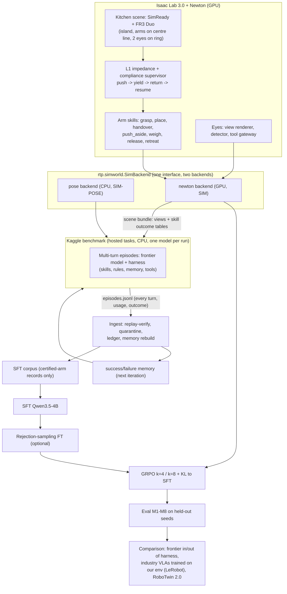
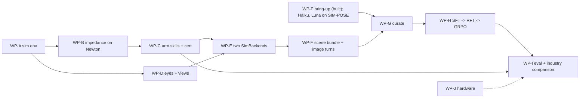

# Agent build spec — what to build, in what order, and how it is proven

**Step-by-step instructions for the local agent (commands, files, acceptance per step, arms first): `docs/AGENT_RUNBOOK.md`. This file is the design behind it.**

Audience: the coding agents building `robot-team-packing`. Authority: `docs/USER_PLAN_VERBATIM.md`, then `IMPLEMENTATION_PLAN.md`, `docs/IMPEDANCE_SPEC.md`, `docs/DATAGEN_KAGGLE.md`, `docs/SCENE_DESIGN.md`, `docs/ASSETS.md`.
Truth source for what already exists: `docs/STATUS_HONEST.md`. Read it before starting any work package (WP); it overrides anything written from memory.

## 0. Ground rules (apply to every WP)

1. **Evidence classes.** Every number you report carries one of: `FIXTURE` (toy world), `SIM-POSE` (CPU asset-backed pose-level world), `SIM-ABSTRACT` (numpy plant), `SIM` (Isaac Lab + Newton articulation/scene), `MODEL` (real weights), `HARDWARE`. Never promote a class (a `SIM-POSE` result is not a `SIM` result). Write the class into the report JSON.
2. **No fabrication.** No result without a run id, config hash, seed list and git SHA. If you could not run it, say "not run" in `STATUS_HONEST.md`.
3. **Simulation = Isaac Lab 3.0 + Newton only** (D-25). SimReady USD for objects/furniture/kitchen; manufacturer models for robots (D-34).
4. **Arms are blind and compliant.** The Brain emits skills, never joints/gains/speeds (D-31). Learned arm policies emit bounded deltas into the impedance layer; clamps are identical in sim and on hardware.
5. **Test namespaces.** Training/datagen seeds >= 100000; held-out test seeds < 100000. Test seeds never enter memory, prompts, SFT or GRPO.
6. **One change set per WP**, delivered as a patch with tests; update `docs/STATUS_HONEST.md` and `DECISIONS.md` in the same patch. `paper/` is never touched.
7. **Gates, not opinions.** A WP is done when its acceptance tests pass and its report JSON exists, not when the code is written.

## 1. The whole system in one picture

## 2. Interfaces every WP codes against

### 2.1 The simulator interface already exists: `rtp.simworld.SimBackend` (do NOT invent a new one)
`SimBackend.reset(seed)`, `run_skill(arm, skill, obj, params) -> SkillReport`, `object_states() -> list[ObjState]`, plus `arm_zones`, `payload`, `force_limit`; `SimWorld(backend)` mirrors simulator state into the symbolic world so `rtp.loop.run_episode`, the rules and the scorer run unchanged; outcome categories come from `rtp.simbridge.report_from_states`; the executor-agnostic regression suite is `rtp.skills.run_regression` / `compare`. Two backends are needed: the **Newton backend** (`isaac/newton_packing_sim.py`, GPU, SIM) and the **bundle backend** (`rtp/env/bundle_backend.py`, CPU, answers from the scene bundle and the certified skill tables, used by the hosted Kaggle episodes). Extensions allowed on top of the protocol: `inject_push(arm, link, wrench, duration)` and an arm-event log (`PUSHED / YIELDED / RESUMED / TOUCH / BLOCKED / FAULT`). Both backends must pass the same `tests/test_simworld.py`-style conformance tests.

### 2.2 Skill API (existing `rtp/skills.py`, extended)
Allowed params only: `grasp{force}`, `place{compartment,orientation}`, `handover{to}`, `weigh{}`, `release{}`, `retreat{}`, `push_aside{}`. The skill layer selects the stiffness profile from the allow-list in `docs/IMPEDANCE_SPEC.md` §5. `SkillReport = {ok, cause, peak_force, deflection_peak, yield_s, resume_err_m, wall_s, arm_model}`.

### 2.3 Scene bundle (new, a directory or dataset, hashable)
`scene_<seed>/{scene.json, objects.json, views/<station>_<zoom>_<pan>_<tilt>.jpg, depth/*.npz, visibility.json}` + `skill_tables/<skill>.json` (certified arm outcome tables) + `manifest.json` (sha256, SimReady asset ids/revisions, git SHA, Newton/Isaac Lab versions).

### 2.4 Episode record (existing `rtp/datagen_run.py`, schema 1)
model, decoding actually used, every turn (completion, usage, latency, finish reason), tool calls, plans, evaluated outcome, `arm_model`, shard, iteration, seed, condition, mode.

### 2.5 SFT example (new, `rtp/sft_format.py`)
Chat JSONL, one episode = one conversation: `system` (rules/skills digest), `user` (scene text + image refs), alternating `assistant` JSON actions (tool call or `submit_plan`, each with a short visible `rationale`) and `user` tool results. Loss only on assistant tokens. Image paths resolve through the scene bundle. Hidden provider reasoning is never available and never a target (only emitted text is stored).

### 2.6 Run card (new, `reports/runs/<run_id>.json`)
`{run_id, git_sha, profile, evidence_class, config_hash, seeds, model_rev, adapter_hash, dataset_hash, metrics, cost, wall, hardware}`. Every table in any report is generated from run cards.

## 3. Work packages

Ordering and owners are in §4. Each WP lists: goal · deliverables · acceptance.

### WP-A — Simulation environment (Isaac Lab 3.0 + Newton)
* **Goal.** A kitchen digital twin you can open, step, render and inspect: island, SimReady kitchen fixtures, two FR3 arms on the centre line, a ring of 12 eye stations, rigid kitchen objects with real mass/friction.
* **Build.**
  1. `ops/install.sh --profile 
` installs the Newton-only Isaac Lab stack from the repo's pinned lock (G-3 already passes on the 4050 and Kaggle T4; keep the lock, do not float versions).
  2. `isaac/scenes/kitchen.py`: builds the scene from `configs/kitchen.yaml` (island, fixtures, arm bases, objects) using `ops/fetch_simready.py` packages and the FR3 Duo/FR3 model (G-5). Layout from D-65; dimensions replaceable by measured values.
  3. Asset ingestion per `docs/ASSETS.md` (catalogue, pinned revisions, attribution, collision modes, G-13). Newton is the only physics.
  4. Determinism: same seed -> same `state_hash` over 1000 steps; a seeded randomiser for object sets/poses/friction/mass.
  5. Inspection: `newton_gl` window / EGL video / Rerun / Viser; a CLI `python -m isaac.view --seed N --record out.mp4`.
* **Acceptance.** G-5, G-13 pass with report JSON; a 10 s video of both arms moving to scripted poses and grasping a rigid object; determinism test; scene load time and steps/s per profile in `reports/sim_scaling_<profile>.json`.

### WP-B — Impedance control and human-push behaviour on the Newton articulation
* **Goal.** The arm behaves as specified in `docs/IMPEDANCE_SPEC.md`: yields to a push like a spring, pauses the plan, returns at bounded speed, resumes. Proven on the Newton articulation, then on hardware.
* **Build.**
  1. `rtp/control/impedance.py` (torch, batched; exists) driven by `rtp/control/compliance.py` (numpy supervisor; exists, SIM-ABSTRACT). Write the glue `rtp/control/newton_arm.py`: reads `q, dq`, computes the Cartesian error and wrench through `Jᵀ`, adds null-space and coriolis, applies torques in **effort mode** (`joint_f`), at the hardware loop rate (target 1 kHz via substeps, policy at 10-30 Hz).
  2. External wrench injection on any link point: Isaac Lab `permanent_wrench_composer.set_forces_and_torques` / `instantaneous_wrench_composer`; direct Newton `state.body_f`. **Gate G-7:** applied impulse per step = F·dt within 2 % with substeps > 1 (proves the every-substep fix is in the pinned tag).
  3. Push-test harness `isaac/tests/push_test.py`: force pulses and ramps on the end-effector and on the elbow (link 4/6), 6 directions, 5-30 N, with 0-3 kg payload, 1-3 ms extra latency, +-20 % inertia/friction error, plus a kinematic human-hand body pushing through a spring-damper contact. Emits `reports/g6_newton_push.json` with the rows of `docs/IMPEDANCE_SPEC.md` §6.
  5. C++ reference of the same law (`cpp/rtp_impedance/`, Eigen) and a golden-vector parity test against the torch/numpy versions (||Δτ|| <= 1e-6) — this is what runs on the real FR3 through `libfranka`.
  6. Replace placeholder caps (`f_lin_max`, `m_max`, `v_lin_max`) with the contact-force/pressure limits read from ISO 10218-2:2025 once the standard is acquired; until then every report says "placeholder".
* **Acceptance.** All §6 rows pass on the Newton articulation (SIM class), zero clamp/leash violations over >= 10^5 random-push steps, parity test passes, OSC cross-check within 10 %. **Not** a safety certificate; hardware validation is WP-J.

### WP-C — Arm skill training (before data generation; D-62)
* **Goal.** Certified arm skills whose outcomes (success, failure cause, forces, push-robustness) are measured in Newton and exported as tables the Kaggle episodes use.
* **Build.**
  1. **Scripted expert** for each skill (grasp, place, handover, push_aside, weigh, release, retreat) emitting `x_ref(t)` + a stiffness-profile choice; success/failure causes use the same vocabulary as `rtp/datagen_memory.FIX` (`slip, crush, out_of_reach, wrong_slot, no_space, ...`).
  2. **Privileged-state expert RL** (SAC) in Isaac Lab on Newton, then **distill to a blind policy** (existing flow-matching head `rtp/flowhead.py`, `train/distill_arm.py`), then **residual SAC** on top. Observations: proprioception, wrench, contact, skill command — no pixels. Actions: bounded Cartesian deltas + stiffness scale in [0.5, 1.5] + gripper. **Random human pushes in every RL episode** so the learned arm yields instead of fighting.
  3. **Reward** = task progress + grasp stability − crush/slip − `‖F‖` above comfort − speed above cap − clamp violations − time; **hard constraints** (not rewards): force/speed/leash clamps, joint limits.
  4. **Certification card** per skill: `reports/arm_cert_<skill>.json` = success rate and failure-cause histogram over >= 500 seeded trials as a function of object mass, friction, fragility, grasp force, position noise; nominal and push-perturbed; compliance rows; Wilson intervals; hash. The scene bundle pins these hashes.
  5. **Outcome model export**: `skill_tables/<skill>.json` used by the CPU episodes to answer "what happens if the model commands this" with measured distributions (sample outcome given parameters), not made-up probabilities. `arm_model` = `newton_cert_<hash>`.
* **Acceptance.** Pre-registered thresholds (proposal: >= 90 % nominal success, >= 80 % under pushes, zero clamp violations) set in `configs/arm_cert.yaml` before training; cards generated by `ops/arm_certify.py`; `rtp.datagen_ingest.sft_eligible` accepts only records produced with a certified `arm_model`.
* **Why first.** Frontier-model episodes are only worth training on if the arm outcomes they were scored against are real. Cheap-model harness/CoT bring-up runs earlier under `sim_pose_v0` and is excluded from SFT.

### WP-D — Eyes (two movable cameras) in simulation
* **Goal.** Two cameras on the ring (12 stations, pan/tilt/zoom) with the full tool surface, occlusion by arms/column/cabinets, and a conventional detector.
* **Build.** Articulated ring/pan/tilt/zoom eye model; tool gateway (`rtp/eyes/gateway.py`) implementing `docs/SCHEMAS.md` (`orbit, pan, tilt, zoom, kernel, detect, segment, focus, crop, snapshot, describe, status`); Newton Warp renderer (rgb + depth only) for views; own CV for segmentation (the renderer has none) and ground truth from sim state for training; ray-cast visibility maps; **view library renderer** `ops/render_views.py` (12 stations × zoom {1,2,4} × pan/tilt grid per scene seed) -> scene bundle; detector trained on randomised renders with held-out stations (licence decision recorded: BSD detector by default, AGPL only if you accept it).
* **Acceptance.** Tool conformance suite; G-8 (>= 10 fps/eye at 640×480 on a 4090-class GPU); visibility analytic tests; detector mAP with intervals on held-out stations and objects; a video of an eye orbiting, losing and regaining an object.

### WP-E — Two `SimBackend`s (Newton and bundle)
* **Goal.** The existing `SimBackend` protocol implemented by the Newton world and by the CPU bundle world, so one harness, one scorer, one Kaggle task serves both.
* **Build.** `isaac/newton_packing_sim.py` (WP-A/B/C), `rtp/env/bundle_backend.py` (loader used by the hosted CPU episodes: eye tools answer from cached views, skills sample certified tables), conformance tests reusing the `rtp.fakesim` / `tests/test_simworld.py` pattern.
* **Acceptance.** Conformance suite green on both backends; for 100 seeds the CPU bundle-backed outcome distribution matches the Newton replay within a stated tolerance (recorded, not assumed); `state_hash` replays deterministic.

### WP-F — The Kaggle benchmark (how frontier models use the environment)
* **Goal.** Frontier models interact with our environment through Kaggle-hosted tasks, multi-turn, with skills, rules, memory and tools exposed; everything is captured.
* **Facts (`KAGGLE_SKILL.md`).** Hosted tasks: CPU only, one model per run, clone-and-pip allowed, no Kaggle Secrets, platform-injected proxy; interactive key = a 6-model subset; the Newton scene cannot run inside a hosted task.
* **Built (fixture-tested, not run on Kaggle):** `rtp/kaggle_chat.py`, `rtp/datagen_run.py`, `rtp/datagen_ingest.py`, `rtp/datagen_memory.py`, `ops/kaggle/multiturn/build_task.py`, `ops/datagen_iterate.py`.
* **Build next.**
  1. **Bundle delivery** to the hosted worker (gate DG-6): tokens cannot be used there, so the scene bundle must be reachable without a secret — a public (CC-BY, attribution included) HF dataset repo of renders and tables, or the repo itself for small bundles. Record which works.
  2. Image turns: `ToolBrain` tool results return `image_url` parts from the view library (DG-5).
  3. Native tool calling vs the JSON-action protocol: keep the **JSON-action protocol** (model-agnostic, fully recorded); add native tool-calling only as an option when a model's JSON adherence is poor, recording which was used.
  4. Arm events inside episodes: `PUSHED/YIELDED/RESUMED` via `inject_push` scenarios (a share of episodes interrupts an arm mid-plan; correct behaviour = wait, then replan only after `RESUMED`).
  5. **Sweeps**: `ops/datagen_iterate.py build` per (model × condition × shard); runs `tasks push/run/download`; `ingest` verifies by replay, quarantines, updates the ledger and writes the next memory; repeat.
  6. **Benchmark publication**: the held-out test set is a fixed seed manifest (`bench/test_manifest.json`, hash pinned); the same hosted task with `mode="eval"` produces M6/M7 rows for each frontier model; results are run cards, never edited by hand.
* **Acceptance.** DG-1…DG-6 in `docs/DATAGEN_KAGGLE.md` §7; Haiku 5.5 then Luna bring-up meets the L1/L2 criteria; replay verification 100 % on genuine records.

### WP-G — Capture, verification and training-data construction
* **Capture** (exists): per turn completion, finish reason, usage (true cost incl. hidden reasoning), latency, request hash, decoding params; tool calls and results; plans; evaluated outcome; arm events; memory notes seen (ids).
* **Verification** (exists): replay through the same code path; quarantine reasons; identity pins; eval never feeds memory.
* **Build.**
  1. **Curation** (`rtp/curate.py`): keep (a) verified successes, (b) verified failures with an attributed cause **as negatives or as recovery examples** (episodes where a failure was followed by a successful replan are the most valuable), (c) drop duplicates (plan-pattern hash), cap per-family and per-model shares so no model dominates, (d) quarantine anything whose rationale contradicts the executed plan.
  2. **Hindsight relabelling** (`rtp/hindsight.py` exists): relabel failed episodes with the goal actually achieved, validated by replay.
  3. **Multi-teacher agreement** as a quality weight (>= 2 models agree + verifier pass = high confidence); weight, do not filter, until the ablation says otherwise.
  4. **Splits** by scene family and by seed, never by turn; held-out layouts/objects excluded from every prompt and memory note.
  5. **Dataset card** (`docs/DATASET_CARD.md`): sources, models, counts per cause/family, cost per accepted example from the ledger, `arm_model` hashes, licence notes.
* **Target size [D]:** >= 5,000 verified episodes across >= 3 models (cheap volume from Haiku/Luna, strong gold slice from Opus/Sonnet/Gemini); adjust after the ledger shows cost per accepted example.
* **Acceptance.** `sft_eligible` filter enforced; dataset hash in every training run card; contamination test (test seeds absent from every artefact).

### WP-H — Training: SFT, then rejection sampling, then GRPO
* **Model/profiles.** Qwen3.5-4B, adapters across attention, DeltaNet, MLP, vision blocks and merger per D-07/08/09; per-profile isolation unchanged. `rtp/trainer.py` (resumable, HF checkpoint shipping), `train/sft_brain.py`, `train/grpo_brain.py` exist: read them first and extend, do not rewrite.
* **Stage 1 — SFT** on the curated multi-turn corpus (§2.5). Per-turn assistant loss; thinking budget capped, rationale field trained; chunked loss (existing). Report loss curves, format-validity rate, plan-pass rate on a validation split, then M3.
* **Stage 2 — Rejection-sampling FT (optional, ablated).** Sample the SFT model in the environment (CPU pose + certified tables), keep verified successes and successful recoveries, fine-tune again. Added only if it beats SFT on validation seeds.
* **Stage 3 — GRPO** (`k = 4` and `k = 8`, two runs for M4/M5): a rollout = a full multi-turn episode in the environment; a group = k samples of the same seed; advantage = reward − group mean (std-normalised). **Reward**: closed-loop success, rules satisfied, plan validity, eye-cost penalty, yield compliance (resuming while `YIELDED` is a violation), length penalty; format validity as a gate. **KL(π‖π_SFT)** logged every step with a hard stop at the budget; frozen merged SFT reference. Sampling by vLLM-served adapter on a 4090/Pro-6000-class GPU; the 4050 and T4 profiles run smaller `k`/shorter episodes and say so in their run cards. Reward-hacking audit: read the top-reward rollouts by hand each run.
* **Other options (only if measured to help):** DPO on verified success/failure pairs from the ledger (same seed, same memory); hindsight-augmented SFT; curriculum by occlusion/handover difficulty. Each is an ablation row, not a default.
* **Acceptance.** Every stage emits a run card with dataset/adapter hashes; GRPO runs stop on KL budget; resume tests; no training run reads a test seed.

### WP-I — Evaluation and comparison with the industry
Three tiers, in order of how directly they compare.

* **Tier 1 — same task, same harness, same scorer (direct).** M1–M8 of `IMPLEMENTATION_PLAN.md` §10: base 4B/9B zero-shot; 4B SFT; SFT+GRPO k=4/k=8; frontier models zero-shot and in the harness; base 4B in the harness. Frontier models are the industry's strongest systems and are available through the Kaggle hosted tasks; pin the model slug and run date in every run card. Test set = held-out seeds across all families (§WP-I.1), >= 30 episodes per family; Wilson intervals and paired bootstrap (`rtp/stats.py`); cost, latency, tokens, tool calls per episode reported next to success.
* **Tier 2 — industry VLA policies on our environment (verified route).** LeRobot (ICLR 2026) supports ACT, Diffusion Policy, π0, π0.5, SmolVLA and GR00T N1.5/N1.7 and the LeRobotDataset v3 format, and has an EnvHub for custom environments/benchmarks. Build `ops/export_lerobot.py` (expert/scripted and certified-policy demonstrations from the Newton env -> LeRobotDataset v3) and `isaac/lerobot_env.py` (our env as a LeRobot/EnvHub environment exposing the low-level interface: end-effector delta pose + gripper at 10-30 Hz **through the same bounded-delta impedance layer**, so VLA and Brain act through the same safe interface). Fine-tune each VLA with LeRobot's default recipe on the same demonstrations, evaluate on the same held-out seeds with the same `final_check`. Disclose that VLAs act on low-level actions while our Brain plans skills; compare success, time, safety metrics, data used, compute used.
* **Tier 3 — external benchmark (optional, heavier).** RoboTwin 2.0: dual-arm, 50 tasks, Franka and UR5 embodiments, Easy/Hard protocols, baselines ACT/DP/DP3/RDT/π0 (SAPIEN-based). Needs a symbolic-skill adapter onto its API; do it only after Tiers 1–2 are complete.
* **WP-I.1 Test families (held-out, all sorts of tasks).** packing variants; heavy/fragile ordering; occlusion-heavy arrangements (column/cabinet/arm occluders); distractors; handover-required; **human-push interruption**; kitchen tasks on SimReady objects (dish rack, container loading); unseen layouts (SimReady Homes); unseen object instances; unseen eye stations.
* **Metrics.** success; plan pass; per-family success; localisation (mAP, centre error); occlusion handling (success vs visibility, ask-another-eye rate); active viewpoint selection (information gain, success vs eye-budget curve vs fixed-view baseline at equal cost); eye-tool redundancy; two-arm coordination (handover success, lock conflicts, idle time); recovery rate; collisions; **compliance** (push deflection vs F/K, settle time, overshoot, return speed, peak force, plan-pause correctness, resume error); time; cost.
* **Ablations (each a row).** one eye vs two; static vs active viewpoints; verifier off; memory off; success-only vs success+failure memory; adapter coverage (full-attention vs DeltaNet vs vision merger); thinking cap; GRPO k; stiffness profiles on/off; certified-arm vs stand-in arm.
* **Fairness rules.** same seeds, same checker, same tools/rules text for every system in a row; no tuning on test seeds; every baseline gets a documented compute/data budget; report failures and non-runnable baselines as such; results come from run cards only.
* **Acceptance.** `ops/eval_matrix.py` regenerates every table from run cards; a re-run reproduces numbers within the stated tolerance; the comparison report states what could and could not be compared.

### WP-J — Hardware track (parallel; does not block simulation)
Procure 2 × FR3 (+ Franka Hand) and mounts per D-29/D-65; read ISO 10218-1/-2:2025; cell risk assessment; `libfranka` bring-up on a PREEMPT_RT PC (G-10: p99 jitter <= 100 µs at 1 kHz); deploy the C++ impedance; hardware push tests with a force gauge and a measuring device (staged: empty cell → trained operator → measuring device → people); build the two eyes (ring rail, PTZ, calibration, G-9); sim-to-real per `IMPLEMENTATION_PLAN.md` §8.5. Evidence class `HARDWARE`; nothing here is claimed until run.

## 4. Order, dependencies, who can start now

**Start immediately (no dependencies):** WP-F bring-up (DG-1, DG-3, DG-4 on `sim_pose_v0`), WP-A (scene + assets), WP-B steps 1–4, WP-J procurement/risk assessment, the `ops/export_lerobot.py` format work for Tier 2, the test-family definitions (WP-I.1) on the pose backend.
**Blocked on certified arms:** WP-G's SFT-eligible corpus, WP-H.

## 5. Where each thing runs

| job | machine | why |
|---|---|---|
| scene build, arm RL, push tests, certification, view rendering | RTX 4090 / Pro 6000 (4050 for small runs; Kaggle T4 as a kernel, G-3 PASS) | Newton on GPU |
| hosted multi-turn episodes (all frontier models) | Kaggle hosted task (CPU) | full model roster, no GPU needed |
| ingest, replay verification, memory, curation | any CPU box | numpy only |
| SFT | 4090 (BF16 LoRA + FA2), Kaggle T4 (fp16, one device at a time, D-56), 4050 (QLoRA, 256-token ceiling, D-47) | per-profile config |
| GRPO sampling + update | 4090 / Pro 6000 | vLLM-served adapter + episodes |
| VLA baselines (LeRobot) | 4090 / Pro 6000 | per LeRobot compute guide |

## 6. Milestones and gates

| milestone | contents | gate (all measured, none assumed) |
|---|---|---|
| M-A | impedance kinematics fixed (A1) + API findings (A2) | `reports/g5_reach.json` PASS, `docs/findings/newton_arm_api.md` |
| M-B | Newton scene + impedance push tests | G-5, G-7, G-13, G-6 on articulation |
| M-C | Kaggle loop proven (cheap models) | DG-1, DG-3, DG-4 |
| M-D | arms certified; scene bundle; image turns | `arm_cert_*.json`, DG-5, DG-6 |
| M-E | corpus >= target; SFT done | dataset card; M3 on validation |
| M-F | GRPO k=4/8; frontier rows | KL within budget; M4–M7 |
| M-G | full matrix + Tier-2 VLAs + ablations | `ops/eval_matrix.py` output; comparison report |
| M-H | hardware push tests, eyes, sim-to-real | G-9, G-10, hardware push rows |

## 7. Do not (known ways agents will go wrong)
* Do not train SFT on records made with `sim_pose_v0`; do not mix test seeds into memory/prompts.
* Do not let a learned policy or the Brain set stiffness, speed or force limits; do not raise a clamp to make a test pass.
* Do not quote placeholder force limits as safety limits.
* Do not report a CPU pose-world number as a simulation result, or a simulation number as a hardware result.
* Do not hand-edit result tables or notebooks; regenerate from run cards / generators.
* Do not rewrite existing modules that work (`rtp/loop.py`, `rtp/toolbrain.py`, `rtp/trainer.py`, `rtp/flowhead.py`); extend them behind tests.
* Do not claim novelty or superiority before the comparison exists; negative results are recorded as they are.
