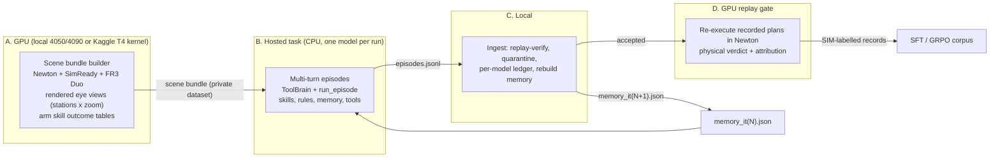

# Multi-turn frontier data generation on Kaggle (HARD REQUIREMENT of `docs/USER_PLAN_VERBATIM.md`)

Directive: put the harness on Kaggle, run **multi-turn episodes** with frontier models on our scene (skills, rules,
memory, tools exposed), **capture, verify and record everything** (which model, what failed, what succeeded), **update
the success/failure memory and repeat**; after thousands of examples go to SFT and GRPO. Cheap models first
(Haiku 5.5, Luna) to prove the pipeline and the CoT, then Opus/Sonnet/new Gemini.

Evidence labels as in `docs/STATUS_HONEST.md`: `FIXTURE`, `SIM-POSE` (CPU, asset-backed pose-level world), `SIM` (Newton),
`MODEL`, `HARDWARE`. Nothing below has been run on Kaggle yet.

## 1. Constraints that fix the architecture (from `KAGGLE_SKILL.md`)
* Hosted tasks: **4 CPU, no GPU, no torch**, Python 3.12, `git` + `pip` + Hugging Face reachable, **one model per run**,
  the platform injects the Model Proxy URL/key, **Kaggle Secrets do not work**, 34 vision-capable hosted models, 16 parallel requests,
  runs of >= 150 min work. The worker can `git clone` the repo's default branch (push first).
* The interactive key reaches only a subset (6 vision models incl. `claude-sonnet-5`, Gemini flash family, `gpt-5.4-nano`); Haiku 5.5, Luna, Opus,
  Astra are **hosted-only**. Locally the proxy is reached through `localhost:10808` (`RTP_HTTP_PROXY`).
* Consequence: the Newton scene (GPU) cannot run inside a hosted task. The loop is therefore split (diagram below). A Kaggle **GPU kernel**
  (T4x2, G-3 PASS) can run Newton, but its model roster is the interactive subset; whether that kernel can call models live is gate DG-2.

## 2. Architecture

| stage | state | notes |
|---|---|---|
| B + C on SIM-POSE (text scene) | **BUILT**, fixture-tested (46 tests, no network) | `rtp/kaggle_chat.py`, `rtp/datagen_run.py`, `rtp/datagen_ingest.py`, `rtp/datagen_memory.py`, `ops/kaggle/multiturn/build_task.py`, `ops/datagen_iterate.py` |
| B with images | design | eye tools answer from a **view library** rendered on GPU in stage A: 12 stations x zoom {1,2,4} x a pan/tilt grid, snapped to the nearest cached view; the model receives `image_url` parts (supported by the transport) |
| A scene bundle | pending P2-P5 | needs the stepped, rendered kitchen and certified arm skills |
| D replay gate | pending P5 | until then the outcome label comes from the SIM-POSE arm model and the record says so (`arm_model: sim_pose_v0`) |

## 3. Arm first (decision D-62)
The arm skills are trained and certified **before** large-scale data generation, because multi-turn episodes need arm
outcomes (grasp slips, crush, reach, push interruptions). Rule enforced in code: every record carries `arm_model`;
`rtp.datagen_ingest.sft_eligible` admits only records made under a **certified** arm model. Bring-up on Haiku/Luna does
**not** wait for the arm: it runs under the stand-in `sim_pose_v0` to prove the pipeline and the CoT, and those records
are for harness/CoT debugging, never SFT. Certification of a skill = pre-registered success threshold met in Newton
(nominal and push-perturbed), compliance rows of G-6/G-6b pass on the Newton articulation, and the outcome table exported as
`reports/arm_cert_<skill>.json` whose hash the scene bundle pins.

## 4. The loop (iterative memory)
1. `python ops/datagen_iterate.py build --iteration N --shard NAME --seeds 100000:100100 --models claude-haiku-5-5 gpt-5.6-luna`
   writes the task with memory notes `runs/datagen/memory_itN.json` embedded and prints the Kaggle commands (push the repo first).
2. Run on Kaggle (`tasks push` / `tasks run -m <bare CLI slug>` / `tasks download`), one model per run, shards sized to finish.
3. `python ops/datagen_iterate.py ingest --shard NAME --iteration N --episodes <downloaded>/episodes.jsonl`:
   * **replay verification**: the recorded model turns are replayed through the same code path on the same seeded world; the
     recomputed outcome must equal the recorded one (tool effects such as `look` repeat exactly). Mismatch, error records,
     wrong seed namespace, missing identity, or an iteration pin mismatch are quarantined with the reason and never feed memory/SFT;
   * per-model ledger entry: episodes, successes, failures by cause, cost, tokens, finish reasons (`runs/datagen/ledger.jsonl`);
   * success/failure memory rebuilt from **all accepted datagen records** (never from eval records) -> `memory_it(N+1).json`.
4. Repeat. Each record stores model, decoding actually used, every turn (completion, usage, latency, finish reason), tool calls, plans,
   evaluated outcome, `arm_model`, shard and iteration, so "what failed and what succeeded, under which model" is a query, not a guess.
Interrupted episodes resume from the per-turn journal and never pay twice for an answered turn; auth/quota/geo errors pause the shard.

## 5. Bring-up ladder (cheap models first)
| step | what | pass criterion |
|---|---|---|
| L0 | fixture transport tests | **done**: 46 tests |
| L1 | 10 episodes, `claude-haiku-5-5`, harness condition | >= 90 % turns parse; `finish_reason != length`; visible rationale present; tool calls meaningful (`look`/`dry_run` before submit); cost within 2x of the table below |
| L2 | same on `gpt-5.6-luna` | same criteria; compare failure causes with L1 |
| L3 | 100 episodes per cheap model x 2 iterations | replay verification 100 % on genuine records; memory iteration changes the failure mix (reported, not assumed to help) |
| L4 | strong models (Opus 5.5, Sonnet 5.5, Gemini 4 Argon / 3.8, Astra) on hard-case slices and the benchmark rows | cost per accepted example recorded in the ledger |
The names in your plan (Astra/Sol 6.2, Luna) are resolved against the live catalogue at run time (the skill lists `gpt-6-astra`, `gpt-6.1-sol`, `gpt-5.6-luna`; `gpt-6-luna` answered wrongly).
Decoding is whatever each model accepts (e.g. `claude-sonnet-5` rejects `temperature`); it is recorded per record and the runs are not assumed repeatable.

## 6. Cost model (ESTIMATES; the ledger's measured cost replaces them)
Measured here: a harness episode's first prompt is about 1.2k tokens and a full text-only episode sends about 6.5k input tokens with a fixed-plan stand-in. Assumed for real models:
text-only episode = 10k input + 4k output tokens (visible rationale + a few tool turns); with images = 60k input + 6k output.
Prices are the indicative $/Mtok in the skill. Daily/monthly dollar caps are read from the skill/CLI at run time; the "per $10" column is only a scale.

**Text-only episode (10k in / 4k out)**

| model (CLI slug) | $/Mtok in/out | cost / episode | episodes per $10 | 300-episode test pass |
|---|---|---|---|---|
| `claude-haiku-5-5` | 0.1/0.5 | $0.0030 | 3,333 | $0.90 |
| `gpt-5.6-luna` | 0.2/1.2 | $0.0068 | 1,470 | $2.04 |
| `gemini-3.8-flash` | 0.75/3.75 | $0.0225 | 444 | $6.75 |
| `claude-sonnet-5-5-default` | 2/10 | $0.0600 | 166 | $18.00 |
| `gemini-4-argon` | 2/10 | $0.0600 | 166 | $18.00 |
| `claude-opus-5-5-default` | 4/20 | $0.1200 | 83 | $36.00 |
| `gpt-6-astra` | 10/50 | $0.3000 | 33 | $90.00 |

**With eye images (60k in / 6k out)**

| model (CLI slug) | $/Mtok in/out | cost / episode | episodes per $10 | 300-episode test pass |
|---|---|---|---|---|
| `claude-haiku-5-5` | 0.1/0.5 | $0.0090 | 1,111 | $2.70 |
| `gpt-5.6-luna` | 0.2/1.2 | $0.0192 | 520 | $5.76 |
| `gemini-3.8-flash` | 0.75/3.75 | $0.0675 | 148 | $20.25 |
| `claude-sonnet-5-5-default` | 2/10 | $0.1800 | 55 | $54.00 |
| `gemini-4-argon` | 2/10 | $0.1800 | 55 | $54.00 |
| `claude-opus-5-5-default` | 4/20 | $0.3600 | 27 | $108.00 |
| `gpt-6-astra` | 10/50 | $0.9000 | 11 | $270.00 |

Reading: thousands of examples are cheap on Haiku/Luna; strong models are used for gold slices and benchmark rows. A 300-episode test pass costs about the last column per condition.

## 7. Gates
| gate | what | pass |
|---|---|---|
| DG-1 | first real hosted run: 10 episodes `claude-haiku-5-5` | manifest `status ok`, L1 criteria met, journal/replay verification 100 % |
| DG-2 | can a Kaggle GPU kernel call models live (interactive key, images, multi-turn)? | yes/no recorded; if yes, a live scene-in-loop path exists for that roster subset |
| DG-3 | replay verification on real (not fixture) records | 100 % genuine accepted; tampered rejected |
| DG-4 | first memory iteration | failure-cause histogram it0 vs it1 reported with counts |
| DG-5 | view-library episode | an `image_url` turn round-trips through the hosted proxy (size <= 5 MB) |
| DG-6 | scene-bundle delivery to the hosted worker without secrets | the worker loads the bundle (public HF dataset repo or the repo itself) and the manifest hash matches |

## 8. Not built yet (honest)
Scene bundle builder, view library, GPU replay gate, certified arm tables, GRPO sampler against this loop, `PUSHED/YIELDED/RESUMED` events inside the pose-level
episodes, held-out test families beyond packing. None of these is claimed anywhere as done.
