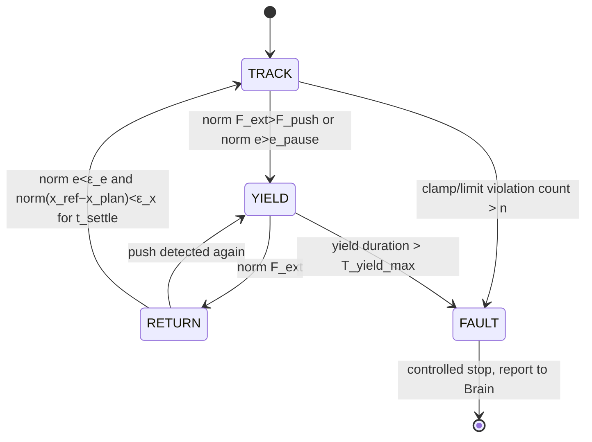

# Impedance and human-push specification (L1)

Requirement (yours): a human can push an arm in any direction; the arm acts as a spring and moves there; when released it comes back to the pose it was planned to be in.
Labels: **[V:S-nn]** verified source · **[D]** default decision, changeable only by a logged decision · **[G]** gate-verified.
All numeric values marked [D] are **starting values**; Phase 3 (sim) and Phase 10 (hardware) replace them with measured, validated ones. Contact-force/pressure limits come from ISO 10218-2:2025 (to be acquired in Phase 10); the force caps below are placeholders until then.

## 1. Verified basis
* Franka's reference Cartesian impedance controller: `τ_task = Jᵀ(−K e − D J q̇)`, null-space PD `(I − Jᵀ J⁺ᵀ)(k_n qe − 2√k_n q̇e)`, `τ = τ_task + τ_null + coriolis`, `D = 2√K`; example gains 150 N/m, 10 Nm/rad; torque-rate saturation 1 Nm/ms; target low-pass 0.005; dual-arm example with null-space stiffness 20 Nm/rad [V:S-20, S-21].
* Firmware Cartesian impedance range up to 3000 N/m, 300 Nm/rad [V:S-21]; collision thresholds set outside the control loop [V:S-21].
* Isaac Lab OSC: `impedance_mode` fixed/variable/variable_kp; `d = 2√k ζ`; inertial decoupling, gravity compensation, null-space [V:S-16].
* Whether the FR3 torque interface expects gravity-free torques and exposes the estimated external wrench in `RobotState` is **[G: read FCI docs in Phase 10]**; the sim controller adds gravity compensation explicitly.

## 2. State machine (per arm)

* **TRACK**: reference follows the plan; plan clock `s` advances.
* **YIELD**: `s` frozen (plan clock gate); `x_ref` held at the last tracked pose, so the spring pulls toward where the arm *should* be; if `‖x − x_ref‖ > δ_max` the held reference follows the person (leash).
* **RETURN**: reference stays at the held planned pose; the arm springs back under the same law; a **speed-saturating damper** keeps `‖ẋ‖ ≤ v_return` (see §3.4); `s` stays frozen until settled, then TRACK resumes — the trajectory continues from where it paused, not from where the person left the arm.
* Brain events: `PUSHED` on entering YIELD, `YIELDED` while held, `RESUMED` on returning to TRACK.

## 3. Control law (1 kHz, identical math in sim and real)

3.1 Error `e = [p − p_ref ; vee(R_ref⁻¹… orientation error)]` (6-D).
3.2 `F_imp = −K e − D ė`, `K = diag(K_lin·I₃, K_rot·I₃)`, `D = 2ζ·√(K·Λ)` with Λ the identified Cartesian inertia (fallback `D = 2√K` as in the reference [V:S-20]); ζ = 1.0 (window 0.9–1.2).
3.3 `τ = Jᵀ F_imp + (I − Jᵀ J⁺ᵀ) τ_null + τ_coriolis (+ τ_gravity in sim)`, `τ_null = k_n (q_n − q) − 2√k_n q̇`, `k_n ≤ 20 Nm/rad` (so the elbow yields).
3.4 Clamps applied in this order: (i) `F_imp` norm cap `F_lin_max`, `M_max`; (ii) **soft speed limiter** `F_lim = −D_lim·(‖ẋ‖ − v_cap)₊·ẋ/‖ẋ‖` with `v_cap = v_lin_max` in TRACK and `v_return` in RETURN; (iii) joint torque saturation; (iv) torque-rate limit 1 Nm/ms [V:S-20]; (v) joint speed/position limits.
3.5 Reference path: planner output → plan clock `s` (gated) → critically damped reference filter (replaces the example's fixed 0.005 low-pass) → `x_ref`.
3.6 Variable stiffness: `K` follows the selected profile through a first-order filter (time constant 0.1 s) so gain changes never step.

## 4. Parameters (initial values [D])

| parameter | value | note |
|---|---|---|
| ζ | 1.0 | critical damping |
| K_lin (N/m) range | 100–800 | firmware max 3000 [V:S-21] |
| K_rot (Nm/rad) range | 8–40 | example 10 [V:S-20] |
| F_push / F_release | 8 N / 4 N | hysteresis; push detection from estimated external wrench |
| e_pause | 0.03 m | also triggers YIELD |
| t_rel | 0.2 s | release debounce |
| δ_max (leash) | 0.20 m | caps spring force at K·δ_max |
| F_lin_max / M_max | 40 N / 4 Nm | **placeholder** until the standard's limits are read |
| v_lin_max | 0.25 m/s | placeholder |
| v_return / ω_return | 0.10 m/s / 0.30 rad/s | |
| T_yield_max | 30 s | then controlled retreat/stop and report |
| torque rate | ≤ 1 Nm/ms | [V:S-20] |
| ε_e / ε_x / t_settle | 3 mm / 3 mm / 0.15 s | resume condition |

## 5. Stiffness profiles (allow-list; Brain cannot set values)

| profile | K_lin (N/m) | K_rot (Nm/rad) | used by |
|---|---|---|---|
| `free_motion` | 200 | 15 | transit between regions |
| `approach` | 300 | 20 | pre-grasp / pre-place |
| `grasp` | 500 | 25 | closing/lift start |
| `transport` | 250 | 15 | carrying an object |
| `place` | 400 | 20 | placing / insertion |
| `retreat` | 200 | 15 | leaving a region |
| `handover` | 150 | 10 | cooperative handover (softest) |
Learned policies may scale a profile within `[0.5×, 1.5×]` and never outside the global range.

## 6. Simulation acceptance (Phase 3; every row must pass)

| test | procedure | pass |
|---|---|---|
| analytic step | 1-DoF mass-spring-damper equivalent, step in `x_ref` | response error ≤ 5 % (G-6) |
| steady deflection | constant force F ∈ {5, 10, 20, 30} N on EE, ±x,±y,±z; torques ±0.5/1 Nm | `|δ| = F/K` within ±10 % |
| release return | release after 1 s hold at δ ≈ 0.10 m | within 5 mm of plan in ≤ 2.5 s; overshoot ≤ 10 % of δ; peak speed ≤ 1.1·v_return |
| no limit cycle | free hold 10 s after return | RMS error ≤ 2 mm |
| plan pause | push during a trajectory | plan clock exactly frozen in YIELD; resumes where paused; resume position error ≤ ε_x |
| whole-arm push | 10–30 N on link 4 (elbow) and link 6 | link yields; EE error ≤ 15 mm; null posture returns ≤ 3 s |
| leash/clamps | random push sequences (property test, ≥ 10⁵ steps) | `‖e‖ ≤ δ_max`, `‖F_cmd‖ ≤ F_lin_max`, torque rate ≤ 1 Nm/ms, speed ≤ 1.1·cap — **zero violations** |
| payload | 0, 1, 2, 3 kg | all rows above still pass |
| robustness | 1–3 ms extra latency, ±20 % inertia/friction error | stable, rows still pass with relaxed bounds recorded |
| human-hand proxy | kinematic hand body pushing via spring-damper contact | measured peak contact force reported; no clamp violation |
| two arms | both arms pushed at once; handover in progress | no coupling instability; handover pauses and resumes |
| controller parity | torch vs C++ reference on golden vectors | `‖Δτ‖ ≤ 1e-6` |
| OSC cross-check | same scenario in Isaac Lab OSC | trajectories agree within 10 % |

## 7. Hardware acceptance (Phase 10)
Same pushes with an instrumented force gauge/load cell at the end-effector and a force-pressure measuring device for contact tests; step responses compared with sim (differences feed identification in Phase 12); all runs with the user-stop at hand [V:S-21]; first tests at the lowest profile (`handover`) and lowest force cap; staged: cell empty → trained operator only → measuring device → people. Collision-behaviour thresholds are configured before motion and verified by a deliberate-contact test.

## 8. Not claimed
This specification defines and tests a **compliance behaviour**. It is not, by itself, a safety certification and does not replace L0 (E-stop, firmware limits, protective stop) or the cell risk assessment; the limits that make it acceptable around people are those measured on the real arms and checked against the standard.
